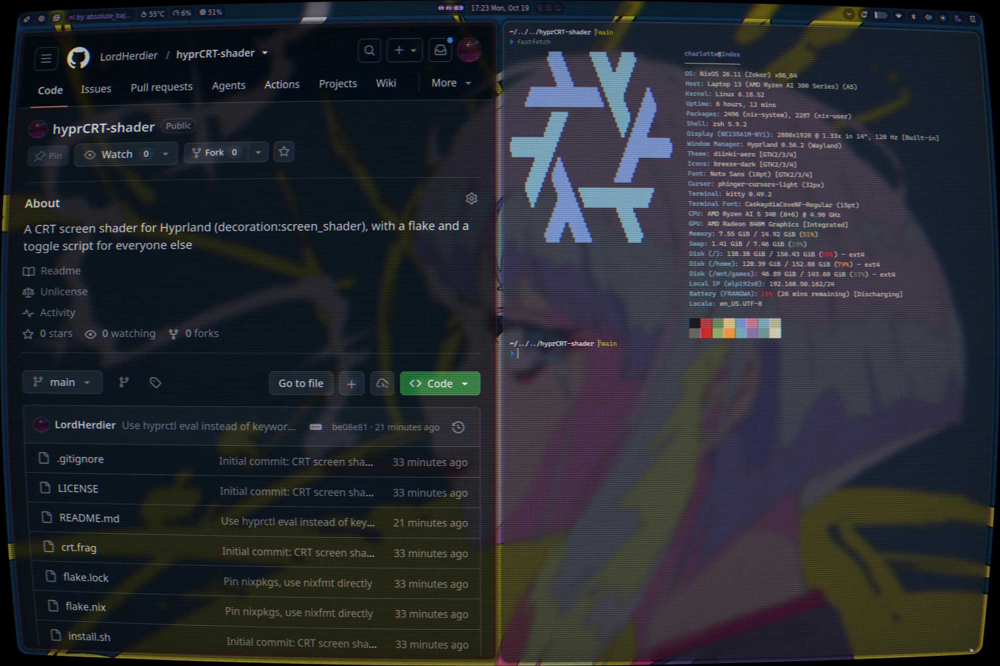
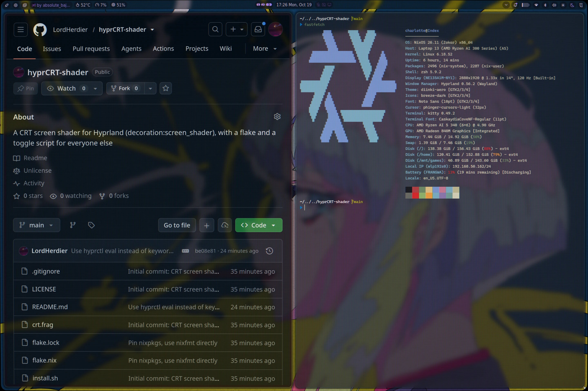
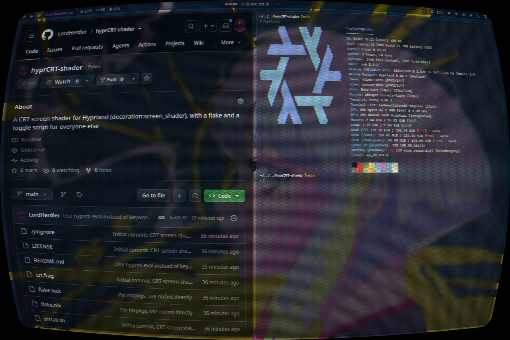
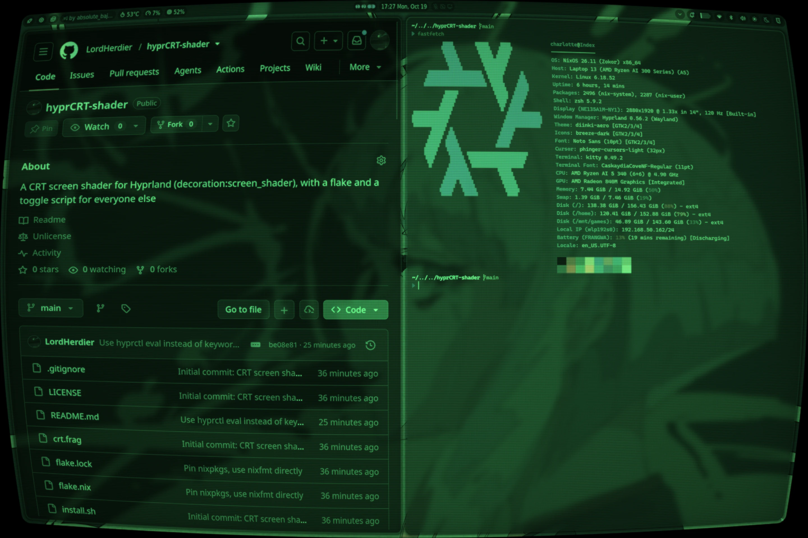
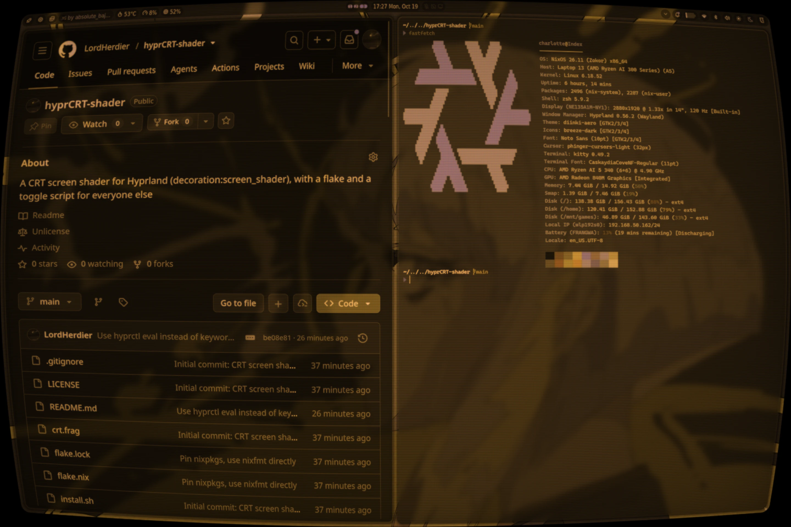

# hyprCRT-shader

A CRT screen filter for [Hyprland](https://hyprland.org)'s
`decoration:screen_shader`, in GLSL ES 300. Barrel distortion,
r/b convergence error, a beam profile that widens with brightness, an
aperture-grille phosphor mask, vignette, rounded bezel corners, and
optional halation/diffusion glow — all running on the final composite,
tuned to look like a tube rather than a "scanlines.png over everything"
filter.

<p align="center">
  
</p>

## Install

### Nix

```
nix run github:LordHerdier/hyprCRT-shader       # toggle it once, right now
```

Or add it as an input and reference the shader file directly from your
Hyprland config:

```nix
inputs.hyprCRT-shader.url = "github:LordHerdier/hyprCRT-shader";
```

```nix
# wherever you write your hyprland.conf / extraConfig
decoration.screen_shader = "${inputs.hyprCRT-shader.packages.${pkgs.system}.default}/share/hyprCRT/crt.frag";
```

If you're toggling it at runtime instead of leaving it always on (see
[Toggling](#toggling) below), `inputs.hyprCRT-shader.packages.${system}.default`
also has `bin/hyprcrt-toggle` on its `$PATH` once installed — bind that
to a key instead of a static `screen_shader` line.

### Anywhere else (Arch, any other distro)

```
git clone https://github.com/LordHerdier/hyprCRT-shader
cd hyprCRT-shader
./install.sh
```

This copies `crt.frag` and `toggle.sh` into
`~/.config/hypr/shaders/`. `jq` has to be on your `$PATH` for
`toggle.sh` — everything else it needs (`hyprctl`) ships with
Hyprland.

## Enable it

The shader needs software cursors — Hyprland warps pixels, not the
cursor, which is drawn into the shader's input texture. Without this a
hardware cursor floats flat over the curve instead of following it:

```ini
cursor {
    no_hardware_cursors = true
}
```

Then either set the shader statically:

```ini
decoration {
    screen_shader = ~/.config/hypr/shaders/crt.frag
}
```

### Toggling

Running the shader costs damage-tracking: see the comment at the top of
`crt.frag` for why. `toggle.sh` handles both halves of that trade in one
place — it flips `decoration:screen_shader` and
`debug:damage_tracking` together, so the full-output-redraw cost is
only ever paid in a session where the shader is actually on:

```ini
bind = SUPER, F12, exec, ~/.config/hypr/shaders/toggle.sh
```

It uses `hyprctl eval` rather than `hyprctl keyword`, so it works the
same way whether your `hyprland.conf` itself is hyprlang or Lua —
`keyword` only writes through the legacy hyprlang parser and fails
outright ("keyword can't work with non-legacy parsers. Use eval.") on
a Lua config.

If your config is already Lua and you'd rather not shell out to
`hyprctl` at all, the same `hl.config` call works inline:

```lua
local shader = os.getenv("HOME") .. "/.config/hypr/shaders/crt.frag"
local enabled = false

local function toggle()
  enabled = not enabled
  hl.config({
    decoration = { screen_shader = enabled and shader or "" },
    debug = { damage_tracking = enabled and 0 or 2 },
  })
end

hl.bind("SUPER", "F12", toggle)
```

## Presets

`presets/` holds ready-made variants of the shader. Each is a complete
copy of `crt.frag` with different constants (Hyprland takes one file,
no `#include`), generated by `presets/generate.py`:

<table>
  <tr>
    <td align="center" width="50%">
      <a href="presets/subtle.frag"></a><br>
      <b><code>subtle</code></b><br>
      <sub>Barely-there: flat glass, faint scanlines, soft mask.</sub>
    </td>
    <td align="center" width="50%">
      <a href="presets/trinitron.frag"></a><br>
      <b><code>trinitron</code></b><br>
      <sub>Sharp PVM-style: near-flat, fine scanlines, crisp grille.</sub>
    </td>
  </tr>
  <tr>
    <td align="center" width="50%">
      <a href="presets/arcade.frag"></a><br>
      <b><code>arcade</code></b><br>
      <sub>Worn cabinet: heavy curve, deep scanlines, slot mask, glow.</sub>
    </td>
    <td align="center" width="50%">
      <a href="presets/green.frag"></a><br>
      <b><code>green</code></b><br>
      <sub>Green-phosphor terminal: monochrome, strong glow.</sub>
    </td>
  </tr>
  <tr>
    <td align="center" width="50%">
      <a href="presets/amber.frag"></a><br>
      <b><code>amber</code></b><br>
      <sub>Amber-phosphor terminal: monochrome, warm glow.</sub>
    </td>
  </tr>
</table>

```
toggle.sh arcade     # on with arcade; again to turn off
toggle.sh green      # while arcade is on: switches straight to green
```

Or point `decoration:screen_shader` at `presets/<name>.frag` directly.
`green` and `amber` and `arcade` enable halation, so they cost more per
frame than the others. To make your own, add an entry to `generate.py`
and re-run it.

## Tuning

Every knob is a `const float` near the top of `crt.frag`, grouped by
stage (glass geometry, beam, phosphor mask, tube, halation) and
commented with what it does and its sane range. `CURVE = 0.0` gives a
flat pane of glass; `SCAN_DEPTH = 0.0` turns off scanlines entirely;
`HALATION` and `DIFFUSION` are both `0.0` by default because halation
costs a 12-tap gaussian per pixel on top of everything else — raise
`HALATION` first if you want the glow.

Each edit needs a compositor reload of the shader (toggle it off and
on again, or re-run `hyprctl eval` with the new path) to take effect.

## License

Unlicense — see [LICENSE](LICENSE). Do whatever you want with it.
